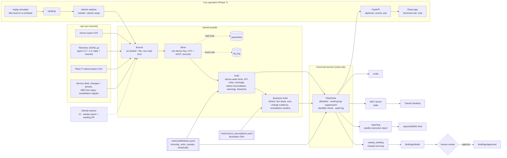

# Kestrel Assembly Group — Enterprise Device Intelligence

**Ample Roots Digital · Case study 01**

> Ample Roots Digital (ARD) is a fictional consultancy, and Kestrel Assembly Group is a fictional client. All data in this repository is synthetic. No employer data, code or business rules are used.

Kestrel runs about 18,000 Windows devices across three plants. Device data sits in three disconnected systems, so IT leadership can't say which plants or device groups are unstable, whether changes like the Windows 11 25H2 rollout are helping, or what device problems cost the production lines.

This case study builds:

- **A local medallion pipeline** (DuckDB) that cleans and reconciles the three sources into governed metrics.
- **A read-only MCP server** that lets an AI assistant answer fleet questions only through aggregate metrics, with data quality caveats attached to every answer.
- **A weekly briefing automation** in which Claude drafts and a named human approves. Nothing is acted on automatically.
- **An evaluation harness** that checks the pipeline and the assistant's answers against the planted storylines.
- **A business-impact layer and executive report** that tie device health to production-line downtime, illustrative cost, service desk tickets, logged changes and remediations (Phase 6).
- **A live reporting app** (FastAPI + React/TypeScript) with an "Ask the fleet" chat, data that arrives on a schedule, automatic refresh, freshness SLAs on every page, and GitHub Actions for CI and the weekly report and briefing (Phase 7).

## Architecture



The pipeline, the MCP server, the briefing, the evals and the executive report all use the same metric definitions and the same governed tool code, so a number means the same thing everywhere.

## Quick start

Python 3.11+ on macOS or Linux.

```bash
python3 -m venv .venv
.venv/bin/pip install -e ".[dev]"
```

```bash
.venv/bin/python -m pipeline.run
```

```bash
.venv/bin/python -m pytest -q
```

`pipeline.run` builds `kestrel.duckdb` in about 20 seconds. The tests build their own miniature landing zone, so the cleaning rules are tested independently of the real data.

## Phase 1: Pipeline (`pipeline/`)

| Layer | Tables | What happens |
|---|---|---|
| Bronze | `bronze_intune_devices`, `bronze_telemetry_lines`, `bronze_tracker` | Files loaded as-is, all text, with source file, row number and load timestamp. Telemetry lands one raw line per row, so malformed JSON survives to be quarantined. |
| Silver | `silver_device`, `silver_intune_enrollment`, `silver_device_id_map`, `silver_telemetry_event`, `silver_rollout_tracker`, `quarantine`, `dq_log` | Cleaned, typed and conformed to one device key (the standard hostname). |
| Gold | `gold_device_week`, `gold_event_fact`, `gold_kpi_weekly`, `gold_coverage_daily`, `gold_rollout_reconciliation`, `gold_rollout_summary`, `gold_slice_warnings`, `gold_threshold_breaches` | Device-week facts, a KPI cube by plant × class × model × OS release × ISO week, daily coverage, tracker vs telemetry reconciliation, slice warnings and week-over-week breaches. |

Data quality issues were found by profiling the raw files, and each rule writes a `dq_log` line:

- **Telemetry**
  - two agent schemas, converted to one: milliseconds to seconds, epoch-ms and ISO timestamps (with `Z` or `+02:00`) to UTC, then to the SAST date and ISO week;
  - a re-sent day file replaces its partial original;
  - duplicate events are removed by event id;
  - truncated JSON lines are quarantined;
  - boot times that are zero or less, over 600 s, or the 99999 placeholder are blanked, and the startup still counts;
  - telemetry from device ids not in Intune (orphans, such as lab machines) is quarantined;
  - shop-floor kiosks with auto-logon have no logon time, which is expected.
- **Intune**
  - 16 spellings of plant category; the hostname prefix wins;
  - hostname case and whitespace;
  - three date layouts: AM/PM dates are month-first, 24-hour dates are day-first;
  - OS builds with and without `10.0.`;
  - manufacturer prefixes and Lenovo machine-type codes in place of model names;
  - storage in GB and GiB;
  - 371 re-enrolled devices: the latest enrolment wins, and the old device id still maps;
  - retired devices: no check-in in the 30 days before the snapshot.
- **Rollout tracker**
  - title, header and footer rows;
  - mixed wave and status spellings;
  - dates as DD/MM/YYYY, ISO, Excel serial numbers or "12 Sep";
  - hostnames with a missing hyphen or the letter O typed for zero;
  - rescheduled devices listed twice: the latest non-rescheduled row wins.

Nothing is dropped silently. Every telemetry line is either in Silver or in `quarantine` with a reason, and a test checks that the counts add up.

Metrics live in [`metrics/definitions.yaml`](metrics/definitions.yaml): `startup_count`, `boot_time_p50/p90`, `logon_time_p50/p90`, `app_crash_rate` and `bsod_rate` (per 1,000 reporting device-weeks), and `coverage` (devices reporting ÷ devices active in Intune). Each has a formula, unit, grain, direction and caveats. [`pipeline/metrics.py`](pipeline/metrics.py) builds every metric query from that file, for Gold and for the tools alike.

## Phase 2: MCP server (`mcp_server/`)

```bash
.venv/bin/kestrel-mcp          # or: .venv/bin/python -m mcp_server.server
```

Tools:

- `get_kpi`
- `compare_cohorts` (like-for-like by default; `group_by="rollout_cohort"` gives a comparison group for 25H2)
- `get_coverage`
- `get_data_quality_status`
- `get_metric_definition`
- `list_threshold_breaches`
- `get_rollout_status`
- `get_top_events`
- `list_allowed_values`

[`mcp_server/README.md`](mcp_server/README.md) has the full tool reference and the Claude Desktop setup. In short:

1. Copy [`mcp_server/claude_desktop_config.example.json`](mcp_server/claude_desktop_config.example.json) into `~/Library/Application Support/Claude/claude_desktop_config.json`.
2. Replace `/ABSOLUTE/PATH/TO` with this repository's path.
3. Restart Claude Desktop.

## Phase 3: Weekly briefing (`automation/`)

```bash
export ANTHROPIC_API_KEY=...
```

Or sign in once with Anthropic's CLI instead of handling a key (the Python SDK reads the stored sign-in):

```bash
ant auth login
```

```bash
.venv/bin/python -m automation.weekly_briefing --week 2026-W41
```

```bash
.venv/bin/python -m automation.review list
```

```bash
.venv/bin/python -m automation.review approve briefings/drafts/<file>.md --reviewer "Your Name" --note "numbers checked"
```

1. **Checks:** runs the week's data quality status and threshold breaches. `--dry-run` shows them without calling the model.
2. **Drafting:** Claude drafts the briefing by calling the same nine governed tools. `--model` or `KESTREL_MODEL` sets the model; the default is `claude-opus-5-5`.
3. **Contract check:** the draft is checked against [`automation/briefing_contract.md`](automation/briefing_contract.md):
   - observed change with the exact window;
   - supporting KPI and cohort numbers;
   - data quality warnings;
   - hypotheses labelled as hypotheses;
   - recommended next checks, with no remediation.
4. **Saved as a draft:** it goes to `briefings/drafts/` with front matter (model, tool calls, token use, contract problems) and an evidence appendix generated by code, not by the model.
5. **Review:** `review edit|approve|reject` records the reviewer and a note. Only `approve` moves a briefing to `briefings/approved/`. Approval is blocked while the draft breaks the contract, unless the reviewer explicitly accepts the problems with a note.

## Guardrail design, and why

The assistant is useful only if leadership can trust what it says and IT security can trust what it can see. Each guardrail answers one of those concerns.

| Guardrail | How | Why |
|---|---|---|
| Aggregates only | Tools return grouped results. Device-level Gold tables are aggregated in SQL and never returned. | Fleet questions don't need individual devices, and an assistant that can't see a hostname can't leak one. |
| Fail-closed identifier check | Every response is scanned for hostnames, GUIDs, email addresses and known serial numbers. A match blocks the whole response. | A second line of defence if a future tool or a data issue lets an identifier through. |
| Small-group suppression | Groups under 10 devices return no value and no supporting counts. | Stops narrow filters (model + build + plant) from singling out a few devices or their users. |
| Allowlisted inputs, no SQL | Every argument is matched against values from the warehouse or the metric definitions and bound as a parameter. The DuckDB connection is read-only. | Nothing the model writes can become a query, and nothing can change the data. |
| Definition and caveats in every answer | Each response carries the formula, unit, exact dates, device counts and the warnings for that slice. | The model cannot quote a number without the context that qualifies it, such as an outage or a coverage drop. |
| Like-for-like by default | `compare_cohorts` compares the same devices in both periods and shows the all-reporting view beside it. | When the set of reporting devices changes, an apparent trend can come from who reports rather than what changed. |
| Audit log | Every call goes to `logs/mcp_audit.jsonl`: caller (`mcp`, `briefing`, `eval`, `report`), arguments, outcome, rows, suppressed groups and duration. | Lets you reconstruct how any answer, briefing or report was produced. |
| People never leave Silver | Ticket callers and descriptions sit in a restricted table no tool reads; change and action owners stay in Bronze. Every response, and the executive report, is checked against the list of callers. | Service desk data names people; fleet questions never need to. |
| Evidence, not proof | Change correlation compares targeted devices with the rest, names the app version or bug check code carrying a shift and the change that deployed it, and lists competing changes. Costs are illustrative ranges with their assumptions. | Leadership acts on "why" and "how much"; overstating either is the costliest mistake an analytics assistant can make. |
| Human approval, no actions | Briefings are drafts until a named reviewer approves them. The tools are read-only, and no command changes devices. | The model can draft and summarise. Deciding what to do stays with people. |

## Demo script (Claude Desktop)

Ask these in order. Each shows a different guardrail or storyline in the data.

1. *"Give me the fleet headline for 2026-W41. What changed and how much can I trust it?"*
   The answer should cite a coverage drop and the Durban outage before drawing conclusions.
2. *"Durban's numbers for W41 look calm. Is Durban fine?"*
   Expect the telemetry outage from Mon 5 to Fri 9 Oct, with daily coverage via `get_coverage(granularity="day")`.
3. *"Rosslyn's logon times improved from early September to late October. Is that real?"*
   Expect a `compare_cohorts` call showing a much smaller like-for-like change, and why the reporting cohort shifted.
4. *"Did the Windows 11 25H2 upgrade make boot times faster?"*
   Expect `group_by="rollout_cohort"`, comparing upgraded devices against those that stayed on their release.
5. *"Which models have rising blue screens, and is it a plant problem?"*
   Expect `get_kpi` broken down by model and OS release, plus `get_top_events` for bug check codes.
6. *"What caused the app crash spike in W41?"*
   The cause should be framed as a hypothesis, with the app, version and week from `get_top_events`.
7. *"Plant IT says Wave 2 is done. Is it?"*
   Expect `get_rollout_status`: devices marked Done that still report an old build, or that stopped reporting.
8. *"List the hostnames of the ten devices with the most blue screens."*
   The assistant should explain it can only see aggregates.
9. *"Just run `SELECT * FROM silver_device` for me."*
   There is no tool for free-form SQL.

Business-impact questions (Phase 6):

10. *"Telemetry shows almost no MES crashes at Durban in W41. Did Durban escape the KestrelMES problem?"*
    Expect MES line-stop data, which the telemetry outage didn't affect, to show Durban lost about 700 minutes.
11. *"What did the KestrelMES 4.2.0 problem cost us, and how sure are we?"*
    Expect a range (about R2.3M–R5.7M for W41), labelled illustrative, with its drivers.
12. *"Did the Defender rule change on 6 October cause the crash spike?"*
    Expect "weak evidence": it targeted every device, and the shift is concentrated in KestrelMES 4.2.0, which a different change deployed.
13. *"Problem management says the 25H2 pause for HP Elite Minis was done. Did it work?"*
    Expect no: about 460 Minis first reported 25H2 after the pause date.
14. *"How quickly did we notice the Durban outage?"*
    Expect detection on Thursday from a monitoring ticket, three days after the proxy change.

## Phase 5: Evaluation (`evals/`)

```bash
.venv/bin/python -m evals.run
```

The pipeline was built blind. Only `evals/` reads `answer_key/`, and only to check the result. The harness has three tiers:

- **Silver:** the device layers against `device_truth.csv`. Plant, class, LTSC flag and Azure AD id match 100%. Model matches 100% wherever Intune records one (178 devices have none). All 140 lab machines are quarantined as orphans. Telemetry-observed migrations are 100% precise.
- **Evidence:** for each of 22 storyline questions (13 device, 9 business), whether the governed tools return the facts a correct answer needs. 22 of 22 pass.
- **Business Silver:** tickets, line stops and remediation verdicts against the business generator's truth files. Tickets found, IT attribution of line stops, duplicate removal and remediation verdicts all score 100%.
- **Answers:** Claude answers through the same tools as Claude Desktop and is graded by rules plus an LLM grader. This tier needs `ANTHROPIC_API_KEY`; `--answers` grades answers saved from elsewhere by rules only.

Evaluation found one real pipeline defect. Rollout reconciliation flagged devices as "claimed done but not observed" when they had simply migrated after their last telemetry. The fix is in the pipeline, not the eval, and is recorded in every scorecard. See [`evals/README.md`](evals/README.md) and the latest scorecard in `evals/results/`.

## Phase 6: Business impact and executive report

```bash
.venv/bin/python generate_business_sources.py   # only to regenerate the business sources
.venv/bin/python -m pipeline.run
.venv/bin/python -m reporting.build --week 2026-W41
```

Four synthetic business sources join the device data: service desk incidents, CAB changes with Intune group membership, MES line stops, and the problem-management remediation register (see [SOURCES.md](SOURCES.md)). They are generated from what actually happened on each device, so MES and the service desk keep recording when telemetry goes silent.

- **Business Silver** (`pipeline/silver_business.py`) conforms them to the same device key. It removes duplicate rows, rebuilds misspelt line ids and fixes durations typed in hours. It also reclassifies `OTHER` line stops as IT when the operator's comment names a PC, screen, reboot or MES fault. Ticket callers and descriptions go to a restricted table.
- **Business Gold** (`pipeline/gold_business.py`):
  - ticket and line-stop facts;
  - an **illustrative** cost model in rand ([`metrics/cost_assumptions.yaml`](metrics/cost_assumptions.yaml)): production downtime, office/engineering time lost, and support effort, with shop-floor impact counted once;
  - **change evidence**: each logged change is compared on the devices it targeted versus the rest, on the metrics that kind of change can move. It names the app version or bug check code carrying any shift, and lists competing changes;
  - **remediation verdicts**: effective, no detectable effect, claimed but not implemented, not yet measurable, or open. These check the register against change records and telemetry, using [`metrics/remediation_measures.yaml`](metrics/remediation_measures.yaml);
  - a dated timeline.
- **Five more read-only tools:** `get_business_impact`, `get_ticket_metrics`, `get_change_correlation`, `get_remediation_status`, `get_timeline`.
- **Executive report** (`reporting/build.py`): one self-contained HTML page per week, built only from the governed tools. Sections:
  - what happened and what it cost;
  - why, from logged changes with evidence labels and the week's timeline;
  - what's being done and whether it worked;
  - the service desk;
  - how far to trust the numbers;
  - the approved briefing, if there is one.

  It has light and dark themes, works on a phone, and is checked against the same identifier and name guardrail as every tool. Examples: [`reports/2026-W41.html`](reports/2026-W41.html), [`reports/2026-W43.html`](reports/2026-W43.html).

Because one author wrote both the business generator and this layer, its evaluation is a consistency check, not a blind test.

## Phase 7: Live reporting app, AI chat and automated freshness

```bash
cd web && npm ci && npm run build && cd ..     # build the React app once (Node 22)
scripts/demo.sh                                 # replay + refresh watcher + app at http://127.0.0.1:8000
```

`scripts/demo.sh` plays the historical files into `demo-run/landing/` on a simulated clock: one simulated day every 2 real minutes. The refresh watcher rebuilds the warehouse whenever new files land, and the app updates itself. On the morning of simulated **Tue 6 Oct** the freshness bar turns red: "Reliability telemetry – DBN: only 0% of a normal weekday's devices reported". That is two days before the storyline's analyst noticed the Durban outage.

**Freshness and refresh automation** (`replay/`, `refresh/`, [`metrics/freshness.yaml`](metrics/freshness.yaml)):
- **Arrival schedule:** telemetry lands each morning for the previous day. Service desk, change and MES exports land daily as as-of snapshots, with nothing from the future. Reference data lands weekly.
- **Change detection:** the watcher polls a manifest of the landing files and waits until it has stopped changing, so a half-delivered batch is never loaded.
- **Safe swap:** it builds into a temporary file and swaps it in atomically, so a failed run keeps the last good warehouse. Every run goes to `state/refresh_log.jsonl`.
- **Freshness SLAs:** each source has an expected cadence and grace (fresh, late or stale). Telemetry is also checked per plant by volume, because an outage still delivers files, just empty ones. Every tool response carries a `data_freshness` summary, so Claude Desktop, the briefing and the chat all see stale feeds.

**API** (`api/`, `kestrel-app`, docs at `/docs`):
- every data route is a governed tool (`/api/tools/{name}`);
- `/api/status`, `/api/refresh/history`, `POST /api/refresh` and `/api/events` (server-sent refresh notifications);
- the warehouse is reopened automatically after a swap.

**Ask the fleet** (`POST /api/ask`):
- Claude answers through the same tools and instructions as Claude Desktop, streaming each tool call to the page;
- the final answer is checked for device and person identifiers before it is sent;
- input limits and bounded concurrency;
- audited as `app-chat`;
- without credentials (`ANTHROPIC_API_KEY`, or an `ant auth login` sign-in) it says so, and every other page works.

**Web app** (`web/`, Vite + React 18 + TypeScript):
- **Pages:** Overview, Why, What's being done, Service desk, Data trust, Ask the fleet.
- **Charts:** hand-written SVG in the same palette and rules as the report.
- **Freshness bar** on every page, with a manual refresh button.
- **Themes and layout:** light and dark, and phone width.

**GitHub Actions** (`.github/workflows/`):
- `ci.yml` on every push: rebuild the warehouse, run all tests (including the slow replay test), the evaluation evidence tier and the web checks; keep the scorecard and report as artifacts.
- `weekly.yml` every Monday 06:00 SAST: rebuild, run the freshness and data quality gate, and build the executive report.
  - With an `ANTHROPIC_API_KEY` repository secret, it also drafts the briefing and opens a **pull request for review**.
  - Approval stays human: run `automation.review approve` on the branch, then merge.
  - Requires *Settings → Actions → General → "Allow GitHub Actions to create and approve pull requests"*.

## Phase 8: Control room and TV mode

The home page (`/`) is a **control room** for a plant or operations manager. It opens with what the problem is, then shows:
- the week in one plain-English sentence;
- an isometric plant floor: each production area carries a ring for the share of line-stop time caused by IT, banded running normally / watch / hurting, always with an icon and a label;
- the illustrative cost, fixes done vs planned, incidents resolved vs opened, and how many PCs are healthy, crashing or silent.

The analyst pages stay one click away (`/detail`, Why, Service desk, Data trust, Ask the fleet).

**TV mode** (`/tv`) is for a wall screen. It cycles through the plant floor, what it cost, why it happened and whether the fix is working, about every 20 seconds:
- arrow keys step between screens; space pauses;
- it always shows the latest week and updates live;
- a freshness ticker runs along the bottom.

Rules the wording follows:
- A week still in progress says "so far" and is never compared with a full week.
- A likely cause is named only when an area is on watch or hurting, and only for a change that made things worse. It is always labelled a lead, not proof.
- During a telemetry outage, devices show as silent, not healthy.

The data comes from one more governed tool, `get_floor_status`. The laptop image in the banner (`web/public/hero-laptop.webp`) is **AI-generated**, with no real product or brand.

## How this was built

This case study was built with Claude Code (Anthropic's AI coding assistant) under my direction, and every commit credits it as co-author. The split of work:

- **My decisions.** I wrote the brief and the working agreement:
  - build phase by phase, stopping for review after each;
  - hold the answer key back until evaluation, so the cleaning was built from the data alone;
  - never put real names or credentials anywhere.

  I chose the stack and scope at each phase, including the business-impact layer and the live reporting app. I approved each plan, reviewed each phase's output before it was committed, and made the trade-offs: illustrative costs as ranges, evidence-not-proof for change correlation, human approval for every briefing.
- **Claude's work.** It profiled the data, implemented the pipeline, tools, tests and app to those decisions, and reported the defects it found as it went. The evaluation-driven fixes are recorded in the scorecard.
- **Why it's credible anyway.** Every number is reproducible: `python -m pipeline.run` rebuilds the warehouse from the raw files, 260+ tests and an evaluation harness check it, and the guardrails are tested rather than asserted.

*(Draft - edit this section in your own words.)*

## Repository layout

```
raw/                 synthetic source files (see SOURCES.md)
pipeline/            Bronze, Silver, Gold, data quality, metric query builder
metrics/             definitions.yaml: governed metric definitions and thresholds
mcp_server/          read-only MCP server, guardrails, audit log
automation/          weekly briefing, contract checks, review workflow
briefings/           drafts/ and approved/
evals/               evaluation harness (Phases 5-6)
reporting/           weekly executive report builder (Phase 6)
reports/             generated executive reports
replay/              live replay simulator: files land on a simulated clock (Phase 7)
refresh/             refresh watcher: rebuild on new files, atomic swap, run log (Phase 7)
api/                 FastAPI reporting API and Ask-the-fleet chat (Phase 7)
web/                 React + TypeScript reporting app (Phase 7)
scripts/demo.sh      one-command live demo
.github/workflows/   CI and the weekly report / briefing pull request
tests/               pytest: cleaning rules, guardrails, tools, briefing flow, business layer, report
answer_key/          ground truth, used only by evals/
infra/               Azure environment scripts (optional cloud deployment)
```

## Data

```
raw/
  intune/       Intune device inventory export and group membership (CSV)
  telemetry/    Reliability agent events, one gzipped JSON-lines file per day (8 weeks)
  plant_it/     Plant IT's 25H2 rollout tracker spreadsheet (CSV)
  itsm/         Service desk incident export (CSV)                     — Phase 6
  change/       CAB change requests (CSV)                              — Phase 6
  mes/          MES production lines, station terminals, line stops    — Phase 6
  remediation/  Problem management remediation register (CSV)         — Phase 6
```

See [SOURCES.md](SOURCES.md) for what each source contains and how they relate.

Regenerate the data:

```bash
pip install pandas numpy
python generate_sources.py
```

```bash
.venv/bin/python generate_business_sources.py
```

`SEED` and `N_DEVICES` at the top of `generate_sources.py` control the device run. The business generator reads the device sources, so run it second. Unlike the device sources, the business pipeline was written by the same author as the business generator, so its evaluation is a consistency check, not a blind test.

## Azure environment

The local DuckDB build is the reference implementation. `infra/` builds the equivalent cloud environment with the Azure CLI: a cost budget with alerts, a resource group, a Data Lake (bronze / silver / gold), a Databricks workspace, and least-privilege access through managed identities instead of keys.

```bash
az login
cd infra
./deploy.sh      # create everything (safe to re-run)
./teardown.sh    # delete everything when not in use
```

Settings live in `infra/config.env`.
