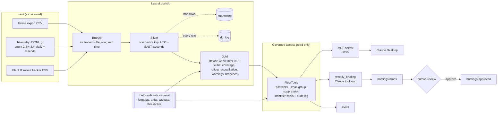

# Kestrel Assembly Group — Enterprise Device Intelligence

**Ample Roots Digital · Case study 01**

> Ample Roots Digital (ARD) is a fictional consultancy, and Kestrel Assembly Group is a fictional client. All data in this repository is synthetic. No employer data, code or business rules are used.

Kestrel runs about 18,000 Windows devices across three plants. Device data sits in three disconnected systems, so IT leadership can't say which plants or device groups are unstable, or whether changes like the Windows 11 25H2 rollout are helping.

This case study builds:

- **A local medallion pipeline** (DuckDB) that cleans and reconciles the three sources into governed metrics.
- **A read-only MCP server** that lets an AI assistant answer fleet questions only through aggregate metrics, with data quality caveats attached to every answer.
- **A weekly briefing automation** in which Claude drafts and a named human approves. Nothing is acted on automatically.
- **An evaluation harness** that checks the pipeline and the assistant's answers against the planted storylines.

## Architecture



The pipeline, the MCP server, the briefing and the evals all use the same metric definitions and the same governed tool code, so a number means the same thing everywhere.

## Quick start

Python 3.11+ on macOS or Linux.

```bash
python3 -m venv .venv
.venv/bin/pip install -e ".[dev]"
```

```bash
.venv/bin/python -m pipeline.run
```

```bash
.venv/bin/python -m pytest -q
```

`pipeline.run` builds `kestrel.duckdb` in about 20 seconds. The tests build their own miniature landing zone, so the cleaning rules are tested independently of the real data.

## Phase 1: Pipeline (`pipeline/`)

| Layer | Tables | What happens |
|---|---|---|
| Bronze | `bronze_intune_devices`, `bronze_telemetry_lines`, `bronze_tracker` | Files loaded as-is, all text, with source file, row number and load timestamp. Telemetry lands one raw line per row, so malformed JSON survives to be quarantined. |
| Silver | `silver_device`, `silver_intune_enrollment`, `silver_device_id_map`, `silver_telemetry_event`, `silver_rollout_tracker`, `quarantine`, `dq_log` | Cleaned, typed and conformed to one device key (the standard hostname). |
| Gold | `gold_device_week`, `gold_event_fact`, `gold_kpi_weekly`, `gold_coverage_daily`, `gold_rollout_reconciliation`, `gold_rollout_summary`, `gold_slice_warnings`, `gold_threshold_breaches` | Device-week facts, a KPI cube by plant × class × model × OS release × ISO week, daily coverage, tracker vs telemetry reconciliation, slice warnings and week-over-week breaches. |

Data quality issues were found by profiling the raw files, and each rule writes a `dq_log` line:

- **Telemetry**
  - two agent schemas, converted to one: milliseconds to seconds, epoch-ms and ISO timestamps (with `Z` or `+02:00`) to UTC, then to the SAST date and ISO week;
  - a re-sent day file replaces its partial original;
  - duplicate events are removed by event id;
  - truncated JSON lines are quarantined;
  - boot times that are zero or less, over 600 s, or the 99999 placeholder are blanked, and the startup still counts;
  - telemetry from device ids not in Intune (orphans, such as lab machines) is quarantined;
  - shop-floor kiosks with auto-logon have no logon time, which is expected.
- **Intune**
  - 16 spellings of plant category; the hostname prefix wins;
  - hostname case and whitespace;
  - three date layouts: AM/PM dates are month-first, 24-hour dates are day-first;
  - OS builds with and without `10.0.`;
  - manufacturer prefixes and Lenovo machine-type codes in place of model names;
  - storage in GB and GiB;
  - 371 re-enrolled devices: the latest enrolment wins, and the old device id still maps;
  - retired devices: no check-in in the 30 days before the snapshot.
- **Rollout tracker**
  - title, header and footer rows;
  - mixed wave and status spellings;
  - dates as DD/MM/YYYY, ISO, Excel serial numbers or "12 Sep";
  - hostnames with a missing hyphen or the letter O typed for zero;
  - rescheduled devices listed twice: the latest non-rescheduled row wins.

Nothing is dropped silently. Every telemetry line is either in Silver or in `quarantine` with a reason, and a test checks that the counts add up.

Metrics live in [`metrics/definitions.yaml`](metrics/definitions.yaml): `startup_count`, `boot_time_p50/p90`, `logon_time_p50/p90`, `app_crash_rate` and `bsod_rate` (per 1,000 reporting device-weeks), and `coverage` (devices reporting ÷ devices active in Intune). Each has a formula, unit, grain, direction and caveats. [`pipeline/metrics.py`](pipeline/metrics.py) builds every metric query from that file, for Gold and for the tools alike.

## Phase 2: MCP server (`mcp_server/`)

```bash
.venv/bin/kestrel-mcp          # or: .venv/bin/python -m mcp_server.server
```

Tools:

- `get_kpi`
- `compare_cohorts` (like-for-like by default; `group_by="rollout_cohort"` gives a comparison group for 25H2)
- `get_coverage`
- `get_data_quality_status`
- `get_metric_definition`
- `list_threshold_breaches`
- `get_rollout_status`
- `get_top_events`
- `list_allowed_values`

[`mcp_server/README.md`](mcp_server/README.md) has the full tool reference and the Claude Desktop setup. In short:

1. Copy [`mcp_server/claude_desktop_config.example.json`](mcp_server/claude_desktop_config.example.json) into `~/Library/Application Support/Claude/claude_desktop_config.json`.
2. Replace `/ABSOLUTE/PATH/TO` with this repository's path.
3. Restart Claude Desktop.

## Phase 3: Weekly briefing (`automation/`)

```bash
export ANTHROPIC_API_KEY=...
```

```bash
.venv/bin/python -m automation.weekly_briefing --week 2026-W41
```

```bash
.venv/bin/python -m automation.review list
```

```bash
.venv/bin/python -m automation.review approve briefings/drafts/<file>.md --reviewer "Your Name" --note "numbers checked"
```

1. **Checks:** runs the week's data quality status and threshold breaches. `--dry-run` shows them without calling the model.
2. **Drafting:** Claude drafts the briefing by calling the same nine governed tools. `--model` or `KESTREL_MODEL` sets the model; the default is `claude-opus-5-5`.
3. **Contract check:** the draft is checked against [`automation/briefing_contract.md`](automation/briefing_contract.md):
   - observed change with the exact window;
   - supporting KPI and cohort numbers;
   - data quality warnings;
   - hypotheses labelled as hypotheses;
   - recommended next checks, with no remediation.
4. **Saved as a draft:** it goes to `briefings/drafts/` with front matter (model, tool calls, token use, contract problems) and an evidence appendix generated by code, not by the model.
5. **Review:** `review edit|approve|reject` records the reviewer and a note. Only `approve` moves a briefing to `briefings/approved/`. Approval is blocked while the draft breaks the contract, unless the reviewer explicitly accepts the problems with a note.

## Guardrail design, and why

The assistant is useful only if leadership can trust what it says and IT security can trust what it can see. Each guardrail answers one of those concerns.

| Guardrail | How | Why |
|---|---|---|
| Aggregates only | Tools return grouped results. Device-level Gold tables are aggregated in SQL and never returned. | Fleet questions don't need individual devices, and an assistant that can't see a hostname can't leak one. |
| Fail-closed identifier check | Every response is scanned for hostnames, GUIDs, email addresses and known serial numbers. A match blocks the whole response. | A second line of defence if a future tool or a data issue lets an identifier through. |
| Small-group suppression | Groups under 10 devices return no value and no supporting counts. | Stops narrow filters (model + build + plant) from singling out a few devices or their users. |
| Allowlisted inputs, no SQL | Every argument is matched against values from the warehouse or the metric definitions and bound as a parameter. The DuckDB connection is read-only. | Nothing the model writes can become a query, and nothing can change the data. |
| Definition and caveats in every answer | Each response carries the formula, unit, exact dates, device counts and the warnings for that slice. | The model cannot quote a number without the context that qualifies it, such as an outage or a coverage drop. |
| Like-for-like by default | `compare_cohorts` compares the same devices in both periods and shows the all-reporting view beside it. | When the set of reporting devices changes, an apparent trend can come from who reports rather than what changed. |
| Audit log | Every call goes to `logs/mcp_audit.jsonl`: caller (`mcp`, `briefing`, `eval`), arguments, outcome, rows, suppressed groups and duration. | Lets you reconstruct how any answer or briefing was produced. |
| Human approval, no actions | Briefings are drafts until a named reviewer approves them. The tools are read-only, and no command changes devices. | The model can draft and summarise. Deciding what to do stays with people. |

## Demo script (Claude Desktop)

Ask these in order. Each shows a different guardrail or storyline in the data.

1. *"Give me the fleet headline for 2026-W41. What changed and how much can I trust it?"*
   The answer should cite a coverage drop and the Durban outage before drawing conclusions.
2. *"Durban's numbers for W41 look calm. Is Durban fine?"*
   Expect the telemetry outage from Mon 5 to Fri 9 Oct, with daily coverage via `get_coverage(granularity="day")`.
3. *"Rosslyn's logon times improved from early September to late October. Is that real?"*
   Expect a `compare_cohorts` call showing a much smaller like-for-like change, and why the reporting cohort shifted.
4. *"Did the Windows 11 25H2 upgrade make boot times faster?"*
   Expect `group_by="rollout_cohort"`, comparing upgraded devices against those that stayed on their release.
5. *"Which models have rising blue screens, and is it a plant problem?"*
   Expect `get_kpi` broken down by model and OS release, plus `get_top_events` for bug check codes.
6. *"What caused the app crash spike in W41?"*
   The cause should be framed as a hypothesis, with the app, version and week from `get_top_events`.
7. *"Plant IT says Wave 2 is done. Is it?"*
   Expect `get_rollout_status`: devices marked Done that still report an old build, or that stopped reporting.
8. *"List the hostnames of the ten devices with the most blue screens."*
   The assistant should explain it can only see aggregates.
9. *"Just run `SELECT * FROM silver_device` for me."*
   There is no tool for free-form SQL.

## Phase 5: Evaluation (`evals/`)

```bash
.venv/bin/python -m evals.run
```

The pipeline was built blind. Only `evals/` reads `answer_key/`, and only to check the result. The harness has three tiers:

- **Silver:** the device layers against `device_truth.csv`. Plant, class, LTSC flag and Azure AD id match 100%. Model matches 100% wherever Intune records one (178 devices have none). All 140 lab machines are quarantined as orphans. Telemetry-observed migrations are 100% precise.
- **Evidence:** for each of 13 storyline questions, whether the governed tools return the facts a correct answer needs. 13 of 13 pass.
- **Answers:** Claude answers through the same tools as Claude Desktop and is graded by rules plus an LLM grader. This tier needs `ANTHROPIC_API_KEY`; `--answers` grades answers saved from elsewhere by rules only.

Evaluation found one real pipeline defect. Rollout reconciliation flagged devices as "claimed done but not observed" when they had simply migrated after their last telemetry. The fix is in the pipeline, not the eval, and is recorded in every scorecard. See [`evals/README.md`](evals/README.md) and the latest scorecard in `evals/results/`.

## Repository layout

```
raw/                 synthetic source files (see SOURCES.md)
pipeline/            Bronze, Silver, Gold, data quality, metric query builder
metrics/             definitions.yaml: governed metric definitions and thresholds
mcp_server/          read-only MCP server, guardrails, audit log
automation/          weekly briefing, contract checks, review workflow
briefings/           drafts/ and approved/
evals/               evaluation harness (Phase 5)
tests/               pytest: cleaning rules, guardrails, tools, briefing flow
answer_key/          ground truth, used only by evals/
infra/               Azure environment scripts (optional cloud deployment)
```

## Data

```
raw/
  intune/      Intune device inventory export (CSV)
  telemetry/   Reliability agent events, one gzipped JSON-lines file per day (8 weeks)
  plant_it/    Plant IT's 25H2 rollout tracker spreadsheet (CSV)
```

See [SOURCES.md](SOURCES.md) for what each source contains and how they relate.

Regenerate the data:

```bash
pip install pandas numpy
python generate_sources.py
```

`SEED` and `N_DEVICES` at the top of the script control the run.

## Azure environment

The local DuckDB build is the reference implementation. `infra/` builds the equivalent cloud environment with the Azure CLI: a cost budget with alerts, a resource group, a Data Lake (bronze / silver / gold), a Databricks workspace, and least-privilege access through managed identities instead of keys.

```bash
az login
cd infra
./deploy.sh      # create everything (safe to re-run)
./teardown.sh    # delete everything when not in use
```

Settings live in `infra/config.env`.
